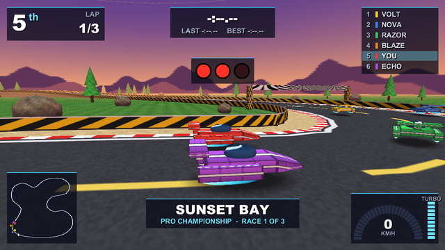
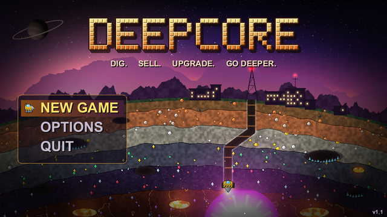
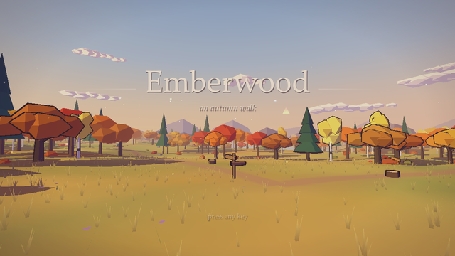
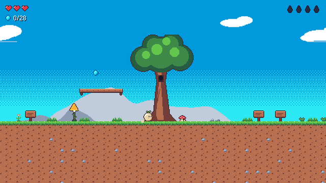
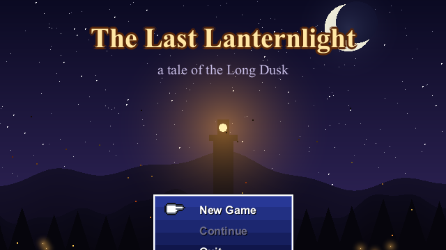
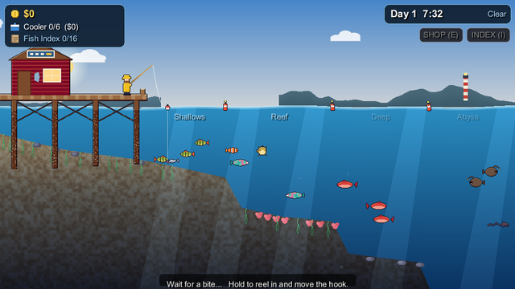
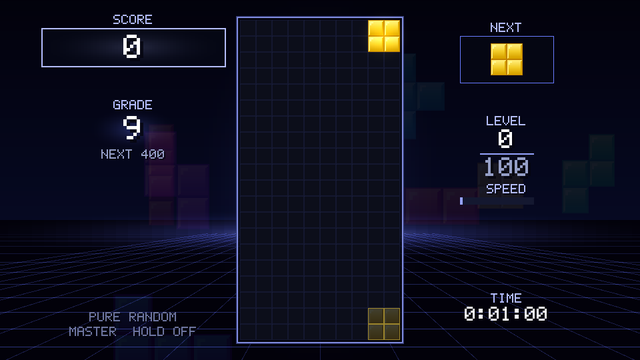
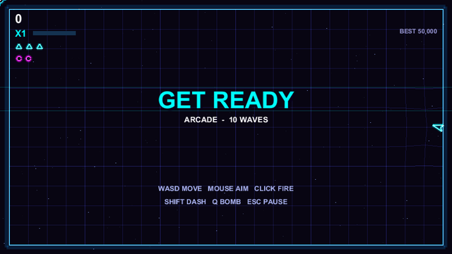
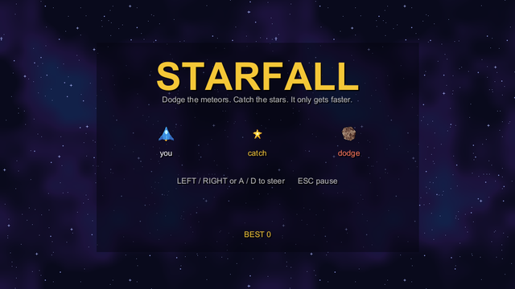
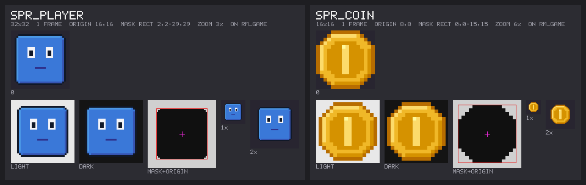

<h1 align="center">Instance Gamekit</h1>

<p align="center">
  <strong>Make GameMaker 8.1 games from plain text files.</strong><br>
  GML in <code>.gml</code> files, sprites drawn as text, music written as notation, all checked and tested from the command line.
</p>

<p align="center">
  <a href="#quick-start">Quick start</a> ·
  <a href="docs/GUIDE.md">The guide</a> ·
  <a href="crates/instance-art/README.md">Art format</a> ·
  <a href="crates/instance-music/README.md">Music notation</a>
</p>

<table>
  <tr>
    <td></td>
    <td></td>
    <td></td>
  </tr>
  <tr>
    <td align="center"><sub><b>Hoverdrome</b> · 3D anti-gravity racing</sub></td>
    <td align="center"><sub><b>Deepcore</b> · dig, sell, upgrade, go deeper</sub></td>
    <td align="center"><sub><b>Emberwood</b> · a first-person walk in 3D</sub></td>
  </tr>
  <tr>
    <td></td>
    <td></td>
    <td></td>
  </tr>
  <tr>
    <td align="center"><sub><b>Thistledown</b> · a calm exploration platformer</sub></td>
    <td align="center"><sub><b>The Last Lanternlight</b> · a complete JRPG</sub></td>
    <td align="center"><sub><b>Tidewater</b> · a cozy fishing game</sub></td>
  </tr>
  <tr>
    <td></td>
    <td></td>
    <td></td>
  </tr>
  <tr>
    <td align="center"><sub><b>Gravity Grade</b> · falling-block stacking</sub></td>
    <td align="center"><sub><b>Neon Swarm</b> · arena shooter</sub></td>
    <td align="center"><sub><b>Starfall</b> · one-screen arcade</sub></td>
  </tr>
</table>

<p align="center"><sub>Games made with the gamekit, running on Instance.</sub></p>

---

## What is this?

[**Instance**](https://github.com/groverburger/instance) is a clean-room reimplementation
of GameMaker 8.1: a runner, an IDE and the `.gm81` file format. Its full feature set is
available, with no editions, so data structures, surfaces, particles, blend modes and 3D
all work.

The **gamekit** has everything you need to make games for it:

- 🧩 **A starter template.** A small, complete game to copy: title screen, gameplay,
  a saved high score.
- 🎨 **`gmk-art`.** Sprites and backgrounds drawn as text, with contact sheets to look at
  and checks that measure them.
- 🎵 **`gmk-music`.** Songs and sound effects written as notation and rendered to MIDI or
  seamless WAV loops.
- 🔊 **`gmk-sounds`.** Measures sounds you can't hear: loudness, clipping, loop seams,
  and effects that sound too much alike.
- 📖 **[The guide](docs/GUIDE.md).** The workflow, GML rules and traps, runtime behaviour,
  headless testing and game design, in one document.

Every part of a game is a text file that you can diff, review and generate. This makes
the gamekit a good fit for **AI coding agents**: an agent can write the code, draw the
sprites, compose the music, then play the game headless and look at screenshots to
check its own work.

## Quick start

You need [Rust](https://rustup.rs) and two checkouts side by side.

```sh
# 1. Instance: the runner, IDE and gmk-check
git clone https://github.com/groverburger/instance.git
(cd instance && cargo build --release)

# 2. The gamekit: gmk-art, gmk-music, gmk-sounds
git clone git@github.com:groverburger/instance-gamekit.git
cd instance-gamekit
cargo build --release
scripts/fetch-soundfont.sh            # or scripts/fetch-soundfont.ps1 on Windows

# 3. Put both tool folders on PATH
export PATH="$PWD/../instance/target/release:$PWD/target/release:$PATH"
```

<details>
<summary>PowerShell</summary>

```powershell
$env:PATH = "$PWD\..\instance\target\release;$PWD\target\release;" + $env:PATH
```
</details>

The gamekit's crates use Instance's `instance-format` crate through the path
`../instance`, set in `Cargo.toml`.

## Your first game

```sh
cp -r games/_template games/mygame && git -C games/mygame init

gmk-art build games/mygame          # art-src/*.art   -> sprites and backgrounds
gmk-check games/mygame              # static checks of the GML and resources
instance-runner games/mygame        # play it: the folder runs directly
instance-ide games/mygame           # or open it in the editor
gmk-pack games/mygame mygame.gm81   # pack it into one .gm81 file to share
```

A game is a **project folder**:

```text
games/mygame/
├── project.toml              settings and metadata
├── objects/obj_player/
│   ├── object.toml           sprite, parent, depth, ...
│   ├── create.gml            one file per event
│   └── step.gml
├── rooms/rm_game/room.toml
├── scripts/scr_text.gml
├── art-src/sprites.art       sprites drawn as text  ──gmk-art build──▶  sprites/
├── music-src/snd_coin.txt    sounds as notation     ──gmk-music────▶  sounds/
└── ...
```

## Art as text

Draw with shapes, ramps and pixel grids, then mirror, shade and outline:

```text
ramp abcde #3a78d8          # five blues, dark (a) to light (e)
color k #101828             # ink
color W #f4f4f8             # eye white

sprite spr_player 32x32
origin center
rect 4 3 24 26 c            # a rounded square body
rect 3 4 26 24 c
rect 9 9 4 6 W              # left eye and half the mouth
rect 10 11 2 3 k
line 13 20 15 20 a
mirror x                    # ...mirrored to make the right half
shade tl                    # light from the top left
outline k
```

`gmk-art sheet` shows each sprite on light and on dark, as a silhouette with its mask
and origin, and at 1× and 2×:

<p align="center"></p>

`gmk-art check` measures what is hard to judge by eye: contrast against the room, stray
pixels, doubled outlines, origins that make flipping jump, tile seams and art that was
changed but not rebuilt. The full format is in
[`crates/instance-art/README.md`](crates/instance-art/README.md).

## Music as text

Write tracks, chord progressions, patterns and drum grids, then render to a tiny MIDI
file or a seamless WAV loop:

```text
title "Meadow"
tempo 96
key A minor

track pad   inst="Pad 2 (warm)" oct=4 vol=70 reverb=80
track bass  inst="Fingered Bass" oct=2 human=6
track drums drums

prog verse = | Am | F | C | G |
pattern walk = 1q. 5e 8q 5q

grid beat
  kick   x.......x.x.....
  snare  ....x.......x...
  hat    x.x.x.x.x.x.x.xo

section A bars=4
  pad:   mp *w over verse
  bass:  mf walk over verse
  drums: beat*4
```

```sh
gmk-music render song.txt -o song.mid           # background music, a few KB
gmk-music render song.txt -o song.wav --loop    # a seamless loop through a SoundFont
gmk-music info song.txt                         # duration, sections, warnings
```

Sound effects are short one-shots with the built-in synthesiser, so they need no
SoundFont:

```text
title "coin pickup"
tempo 240
time 1/4
track coin synth=square oct=5 vol=100 attack=0 decay=40 sustain=30 release=20
coin: f B5s E6e.
```

The full notation is in [`crates/instance-music/README.md`](crates/instance-music/README.md).

## Test without a window

`instance-runner` can play a game headless, with deterministic input, injected GML,
value watches and screenshots at chosen steps:

```sh
instance-runner games/mygame --headless --no-read-fallback --save-dir /tmp/run \
  --input "40:press:enter,60:down:right,200:up:right" \
  --watch 30:global.score \
  --screenshot-at 60,200,450 /tmp/shots
```

`--random-input SEED` adds a reproducible monkey test, and `--audio-out` records what the
game sounded like. `--save-dir` and `--no-read-fallback` keep test runs away from the
player's real save files.

## Repository layout

| Path | What's there |
|---|---|
| [`docs/GUIDE.md`](docs/GUIDE.md) | the guide to making games with Instance |
| [`games/_template/`](games/_template/) | a small complete game to start from |
| `games/<name>/` | your games: each one is its own git repository (ignored here) |
| [`crates/instance-art/`](crates/instance-art/) | `gmk-art`: `build`, `sheet` and `check` for sprites and backgrounds |
| [`crates/instance-music/`](crates/instance-music/) | `gmk-music` (notation to MIDI/WAV) and `gmk-sounds` (sound analysis) |
| [`music_demos/`](music_demos/) | longer example songs |
| [`scripts/`](scripts/) | `fetch-soundfont` downloads the General MIDI SoundFonts |

**Each game is its own git repository** inside `games/`. This repository ignores
everything there except the template. The template's `.gitignore` keeps the save files
a game writes into its own folder (`*.sav`, `*.ini`, ...) out of git.

## Before you write GML

GameMaker 8.1's GML has a few traps. Read [the guide](docs/GUIDE.md) first. The worst
ones:

- **No short-circuit evaluation.** `if (i < n && a[i] > 0)` evaluates `a[i]` even when
  `i >= n`.
- **`&&`, `||` and `^^` share one precedence level.** Bracket mixed conditions.
- **Scripts need exact argument counts.**

## SoundFonts and licensing

`scripts/fetch-soundfont` downloads two General MIDI SoundFonts into `soundfonts/`:

- `default.sf2` is the **Arachno SoundFont**. Its author can't recommend commercial use,
  because it contains samples by other authors.
- `GeneralUser-GS.sf2` is **GeneralUser GS**, which is free for commercial use. Render
  music for a game you sell with `--soundfont soundfonts/GeneralUser-GS.sf2`.

The gamekit itself is licensed under either the [MIT license](LICENSE-MIT) or the
[Apache License 2.0](LICENSE-APACHE), at your option.
